<div align="center">

# kubedojo

**Get good at Linux and Kubernetes by doing, not by reading.**

A place to train for developers, SREs and anyone who runs software. Real clusters, a real terminal in
your browser, tasks graded automatically, with an explanation for every point you miss. Use it to keep
your skills sharp, or to prepare for the five exams on the road to Kubestronaut — **KCNA**, **CKAD**,
**CKA**, **KCSA**, **CKS** — and the Linux and Vim skills they assume.

[](https://github.com/Mistral-valaise/kubedojo/actions/workflows/ci.yaml)
[](https://github.com/Mistral-valaise/kubedojo/releases)
[](LICENSE)


[Quick start](#quick-start) · [What you can do](#what-you-can-do) · [How it works](#how-it-works) · [Run it for your team](#run-it-for-your-team) · [Contribute](#contributing)

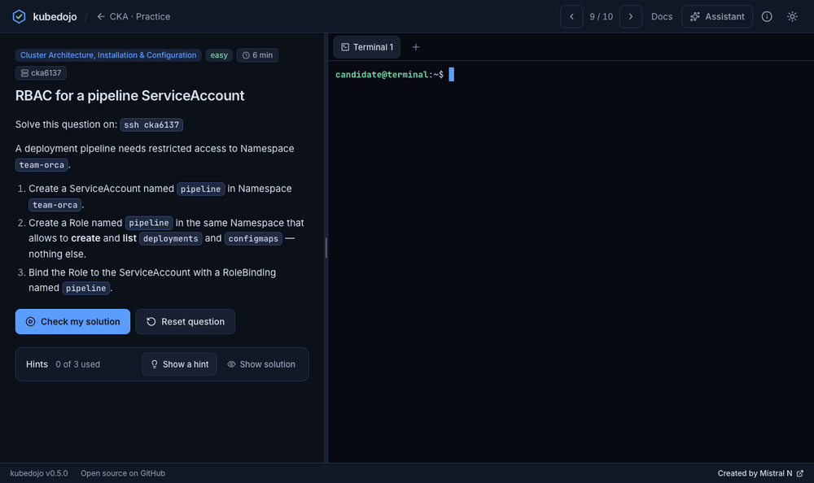

[Watch the tour](docs/media/kubedojo-promo.mp4) (MP4, 85 seconds, with sound; [credits](docs/media/CREDITS.md))

</div>

## Why kubedojo

Understanding a system and being able to operate it are different skills, and only the second one
fades when you stop using it. That matters more now that an AI assistant can write the manifest or the
shell one-liner for you: somebody still has to know what it does, notice when it is wrong, and fix the
cluster at the terminal when it breaks. Linux and Kubernetes sit under most of the software that runs
today, so they are a good place to stay in practice.

kubedojo is built for that practice. The exams are one reason to use it, not the only one:

- **For the job.** Open any task in any track, solve it on a real host or cluster, get graded. No exam
  date needed.
- **For the exam.** The same tasks, timed and weighted like the certification, with a report per domain.
- **It keeps moving.** Questions are plain files, proven by an automated test, so they are updated as
  Kubernetes changes. A track is a directory: new modules on other topics can be added the same way
  ([docs/adding-a-track.md](docs/adding-a-track.md)).

The CKA, CKAD and CKS are performance exams: two hours, a terminal, real clusters. Reading does not prepare
you for that — repetition under exam conditions does. kubedojo gives you exactly that loop, on your own
machine, for free. And it starts one step earlier and goes one step further: the shell and the editor
the exams take for granted, and the two theory exams that complete the set.

| Step | Track | Kind | What you practise |
|---|---|---|---|
| Foundation | **Linux & Vim Essentials** | hands-on, a Linux host | 40 exercises: pipes, logs, Vim, permissions, processes, ssh, bash |
| 1 | **KCNA** | theory | 43 multiple-choice questions, mock exams of 30 in 45 minutes |
| 2 | **CKAD** | hands-on, a cluster | 22 tasks: build, deploy, configure and expose applications |
| 3 | **CKA** | hands-on, clusters | 37 tasks: install, operate and troubleshoot clusters |
| 4 | **KCSA** | theory | 41 multiple-choice questions, mock exams of 30 in 45 minutes |
| 5 | **CKS** | hands-on, clusters | 29 tasks: harden clusters, workloads and the supply chain |

The order is a recommendation and nothing is locked. Why it is this order, and what each track leaves
out: [docs/curriculum-design.md](docs/curriculum-design.md).

| | |
|---|---|
| 🎯 **Exam-format tasks** | 212 original questions in six tracks, across all exam domains, weighted like the real exams. |
| 🖥️ **Real clusters** | kubeadm, systemd, kubelet, etcd, static Pods. Break a kubelet, restore etcd, encrypt Secrets at rest, build an image with podman. |
| ✅ **Feedback that teaches** | Every check shows what was expected, what was found, why it matters — and the command that checked it. |
| ⏱️ **Timed simulations** | 120 minutes, no hints, a report with your score per domain and a clear pass or fail. |
| 🔒 **Nothing leaves your machine** | Runs locally in Docker. No account, no cloud, no time limit. |

Every hands-on question is **proven**: an automated test sets it up, confirms the checks fail, applies
the reference solution and confirms they pass. Every multiple-choice question cites the official page
it was written from and was answered blind by a second reader before it shipped.

## Quick start

You need [Docker](https://docs.docker.com/get-docker/) (Docker Desktop, OrbStack or Colima) with at least
4 GB of memory — 8 GB for full exams — and [kind](https://kind.sigs.k8s.io/).

```bash
brew install kind
```

Download the binary for your platform from the
[latest release](https://github.com/Mistral-valaise/kubedojo/releases/latest), unpack it and run:

```bash
./kubedojo up
```

`kubedojo up` checks your machine, builds the two sandbox images on first run (a few minutes, once; again when a new kubedojo
version adds tools to them) and
opens <http://127.0.0.1:4400>. Pick a track, open a question, and a cluster is ready in about half a
minute.

<details>
<summary>Build from source</summary>

Needs Go 1.26+ and Node 24+.

```bash
git clone https://github.com/Mistral-valaise/kubedojo && cd kubedojo
make build
./bin/kubedojo up
```
</details>

<details>
<summary>Commands and flags</summary>

```text
kubedojo up          Start kubedojo locally and open it in your browser
kubedojo serve       Run the server only (containers, Kubernetes)
kubedojo doctor      Check that this machine can run sandboxes
kubedojo down        Remove every sandbox kubedojo created
kubedojo ratings     Show the feedback learners left on questions
kubedojo observability up | status | stop | reset
kubedojo content lint | test | export
kubedojo version
```

Useful flags for `up`: `--observability` (local Grafana with dashboards; ports and retention are in
[docs/observability.md](docs/observability.md#the-local-stack)), `--addr`, `--no-open`,
`--kubernetes-version`, `--registry-cache=false`, `--allowed-hosts` (the names the server answers
under, when it is reached under more than `localhost`). The optional AI assistant is set up on the Settings
page of the UI, or with flags: Claude with `ANTHROPIC_API_KEY`, any OpenAI-compatible server such as a
local Ollama with `--ai --ai-provider openai --ai-base-url http://localhost:11434/v1 --ai-model llama3.2`.
See [docs/assistant.md](docs/assistant.md).
</details>

macOS is the primary platform. Linux works the same way; `kubedojo doctor` tells you if the inotify limits
need raising for several clusters. On Windows, run kubedojo inside WSL 2 with Docker Desktop's WSL
integration; the native Windows build compiles but is not tested yet.

## What you can do

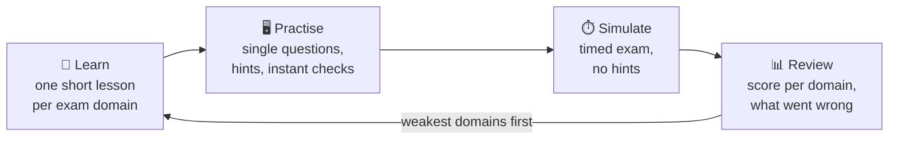

### Learn — the 20% that solves 80%

One short lesson per exam domain, written as a cheat sheet you can finish in five minutes. Click any
command or name to copy it.

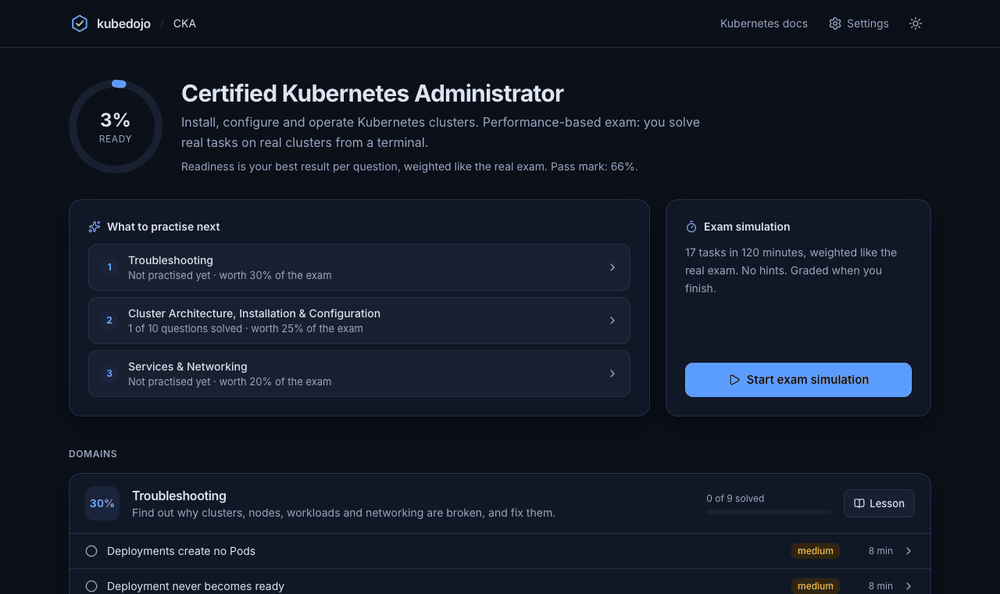

### Practise — one question, instant feedback

The task on the left, `candidate@terminal` on the right. Connect to the cluster with `ssh`, solve the
task, press **Check**. Each check tells you what it expected, what it found and why that matters.
Stuck? Three hints, from a nudge to nearly the command, then the worked solution. Commands in hints and
solutions have a **Run** button that types them into your terminal.

Do not see why a check fails? With the optional **assistant** switched on, **Explain what went wrong**
opens it next to the task and the terminal. It answers from your task, the check results and a read-only
look at your sandbox, and runs nothing itself. The model is yours to choose, in **Settings**: Claude, or any
OpenAI-compatible server such as a local Ollama, where nothing leaves your machine. It is not there
during an exam. More in [docs/assistant.md](docs/assistant.md).

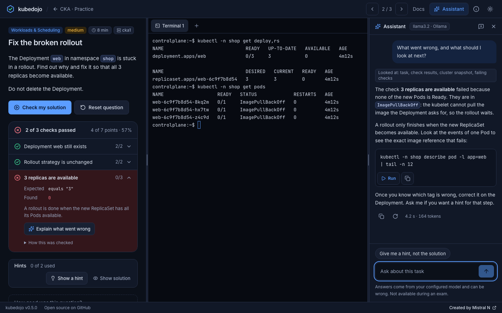

Need a second shell? The **+** next to the terminal tabs opens another one in the same sandbox — keep
`watch kubectl get pods` running in one tab while you work in the other. Each tab is its own shell with
its own scrollback; up to four can be open (`--max-terminals`). `Alt+Shift+T` opens a tab,
`Alt+Shift+W` closes it, `Alt+Shift+←/→` and `Alt+Shift+1…9` switch. On macOS the shortcuts use
`Ctrl+Option` instead of `Alt+Shift`, because Option and Option+Shift type characters there
(`|`, `\`, `{`, `[`, `@` on a German keyboard).

### Simulate — the exam, timed

A full exam is 16–17 tasks in 120 minutes, weighted by domain like the real thing. CKA and CKS
exams span two clusters, CKAD one. A KCNA or KCSA mock exam is 30 questions in 45 minutes, closed
book like the real one, and needs no cluster at all. The Linux skills assessment is 15 exercises in
60 minutes on a Linux host that starts in a second. Flag tasks, keep notes, no feedback until you finish. Then you get the report: pass or fail, your
score per domain, and every check of every task.

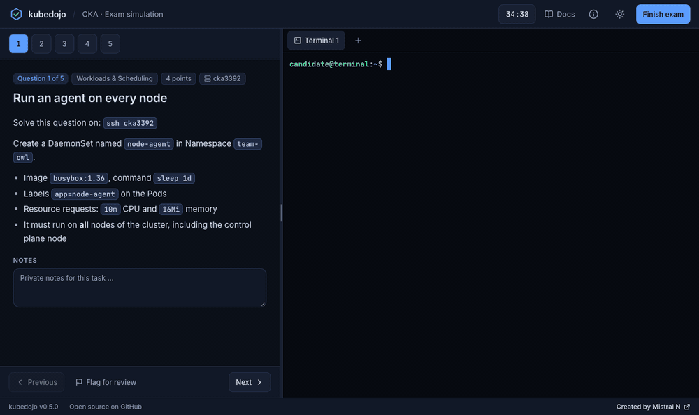

### Track — know when you are ready

kubedojo keeps your best result per question, weights it like the exam and tells you what to practise
next.

| Tracks | Report |
|---|---|
| 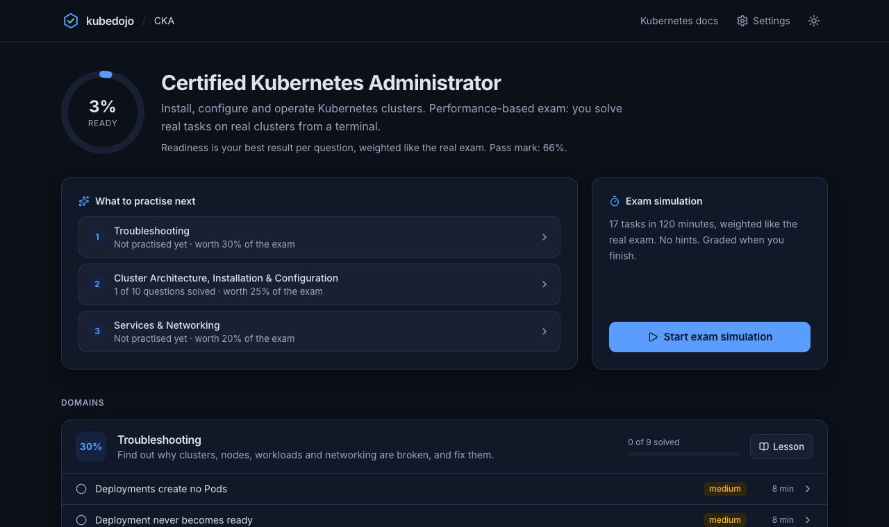 | 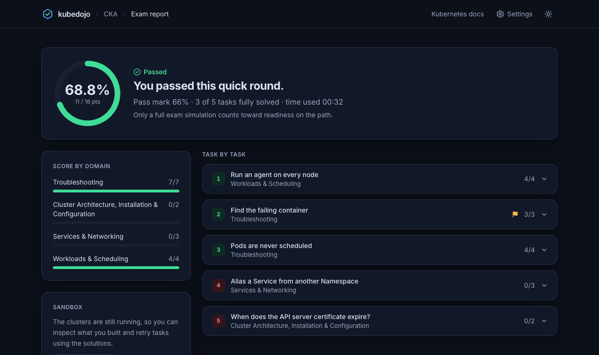 |

## How it works

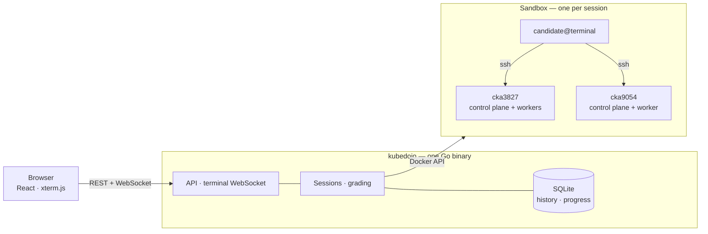

Each cluster is a set of `kindest/node` containers — real systemd, kubelet, kubeadm, etcd and static
Pods — extended with sshd and a `candidate` user, so `ssh cka3827` works like in the exam.

### How a question is graded

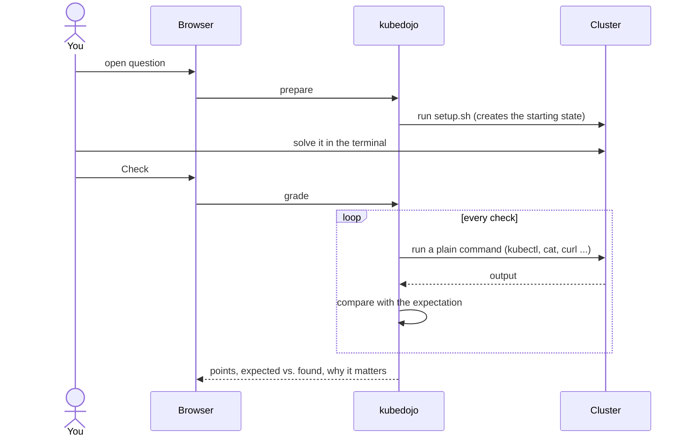

Checks are plain commands with an expected result, so the grader never knows more than you could find
out yourself. A question is a directory with a task, checks, a setup script and a reference solution —
see [docs/writing-questions.md](docs/writing-questions.md). A whole new track:
[docs/adding-a-track.md](docs/adding-a-track.md). How the CKS questions map to the official
curriculum, and which objectives are not covered yet:
[docs/cks-coverage.md](docs/cks-coverage.md).

## Run it for your team

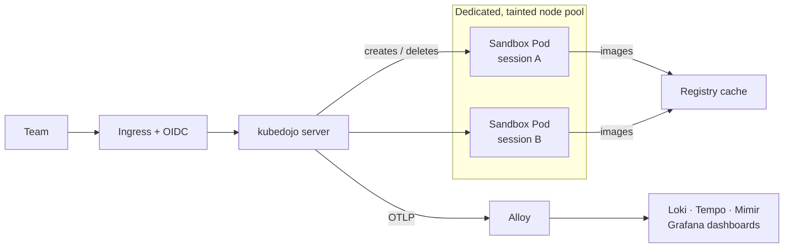

```bash
kubedojo doctor --kubernetes --deep          # is this cluster fit for it?
kubectl create namespace kubedojo
kubectl label namespace kubedojo pod-security.kubernetes.io/enforce=privileged
helm install kubedojo oci://ghcr.io/mistral-valaise/charts/kubedojo --version <release> \
  -n kubedojo -f my-values.yaml --wait
kubectl -n kubedojo exec deploy/kubedojo -c kubedojo -- kubedojo doctor --hosted --cluster
```

In hosted mode every session gets its own Pod running Docker-in-Docker, in which the same sandbox is
created. It is tested on single-node **k3s**: a mini-PC or a VM is enough for a handful of people.
[docs/deployment-k3s.md](docs/deployment-k3s.md) goes from an empty machine to a learner in the
browser and back, with two values files to start from; [docs/deployment.md](docs/deployment.md) is
the reference, including what is tested and what is not.

> [!WARNING]
> Sandbox Pods are **privileged**. Hosted mode is for one team that trusts each other, on a dedicated
> node pool, behind authentication. Read [docs/deployment.md](docs/deployment.md) before you expose it.

### Observability

```sh
kubedojo up --observability
```

starts Grafana next to kubedojo, on <http://127.0.0.1:3000>, with Prometheus, Loki, Tempo and an
OpenTelemetry Collector in one container. You get six dashboards, seven alert rules and working
links between the signals: from a slow sandbox start in a graph to its trace, from the trace to its
log lines, and back. A trace reads from the request down to every check with its outcome, and, with
the assistant, down to the call to the model with its tokens (OpenTelemetry GenAI conventions). It
needs Docker and nothing else.

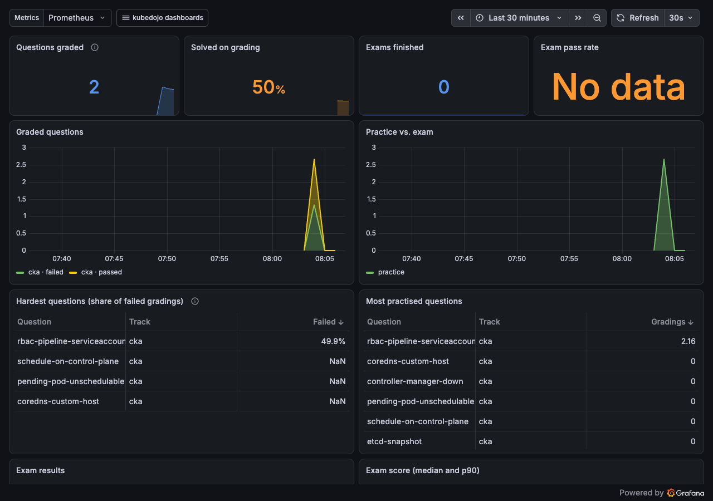

kubedojo speaks OpenTelemetry, so your own stack works as well: point
`OTEL_EXPORTER_OTLP_ENDPOINT` (or `telemetry.otlpEndpoint` in the chart) at an OTLP/HTTP receiver
such as Grafana Alloy. The chart ships the dashboards and the alert rules.

The local stack, a first investigation, the metric reference and troubleshooting:
[docs/observability.md](docs/observability.md).

## Scope and limits

- The kind driver covers everything that works on a container-based node. Tasks that need a real kernel
  boundary or a package manager on the node — AppArmor, gVisor, Falco with eBPF, `apt`-based kubeadm
  upgrades — are not included yet. They are planned for a VM driver; the driver interface is in place.
- The Linux track runs in a container without systemd. It teaches processes, signals and `service`
  scripts; `systemctl` appears in the lesson only. It is a foundation, not an LFCS simulator.
- A mock exam uses kubedojo's own questions. Passing it says the material sits, not what the proctored
  exam will ask. For KCNA and KCSA it is half the length of the real exam, at the same pace.
- Hosted mode is single-tenant. It is not a hardened multi-tenant service.
- Kubernetes moves fast and so do the exams. Lessons and questions target Kubernetes v1.37.

## Contributing

Questions and lessons are plain files under [`content/`](content), and new questions are very welcome —
`kubedojo content test --question <id>` tells you whether yours works. Start with
[CONTRIBUTING.md](CONTRIBUTING.md).

All content is original. Please do not submit questions copied from commercial exam simulators or from
the real exams.

Questions can also be exported as [Killercoda](https://killercoda.com) scenarios:
`kubedojo content export --format killercoda`.

kubedojo is an independent project, not affiliated with or endorsed by the Linux Foundation or the
CNCF, and it awards no title or certificate. Kubestronaut is a program of the CNCF. Kubernetes, KCNA,
KCSA, CKA, CKAD, CKS and Kubestronaut are trademarks of the Linux Foundation.

## License

[Apache-2.0](LICENSE)
