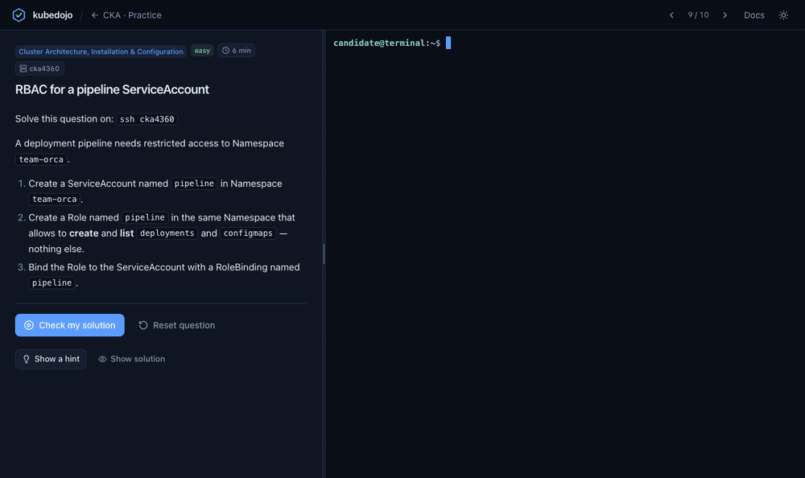
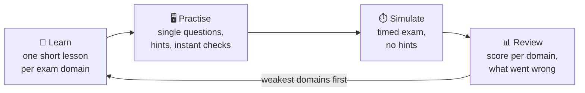
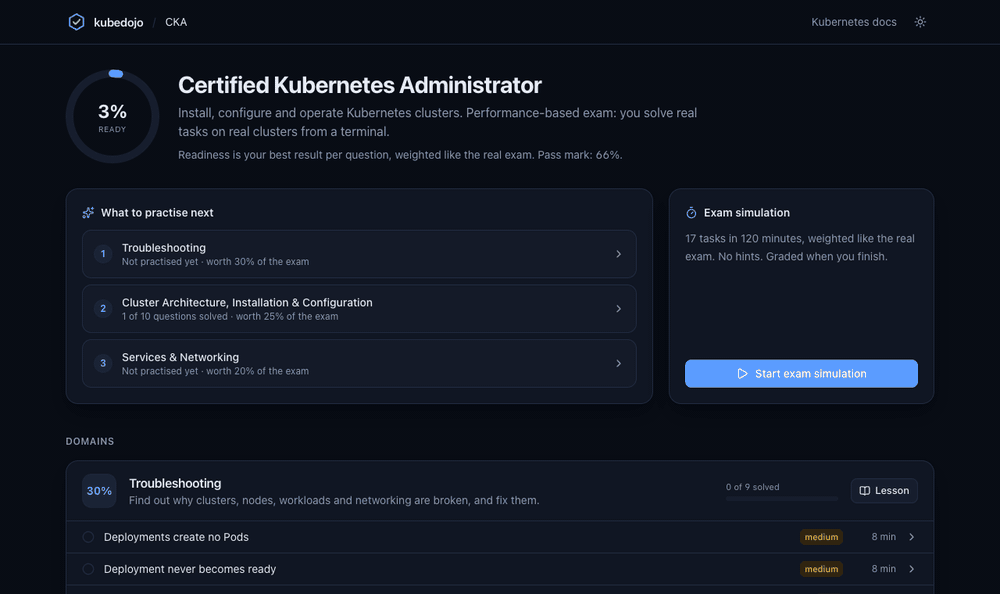
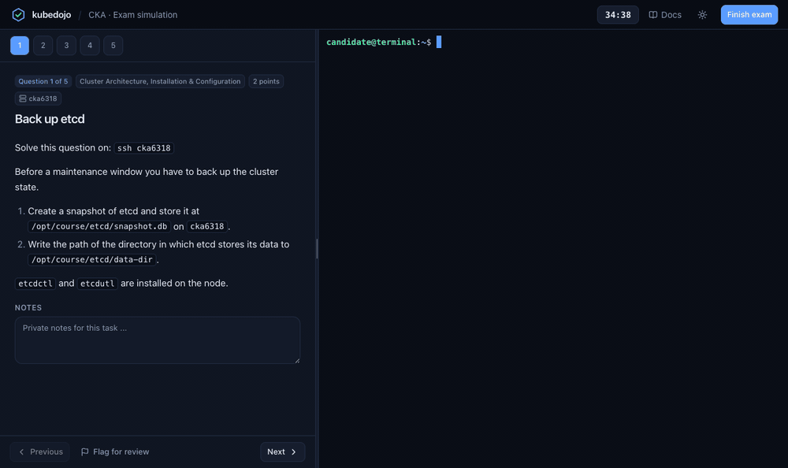
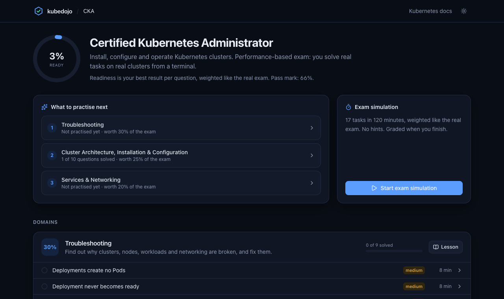
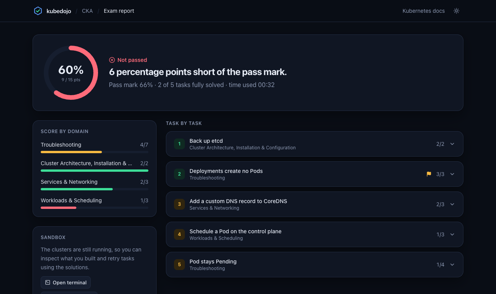
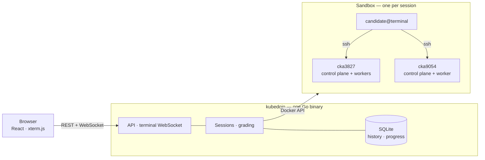
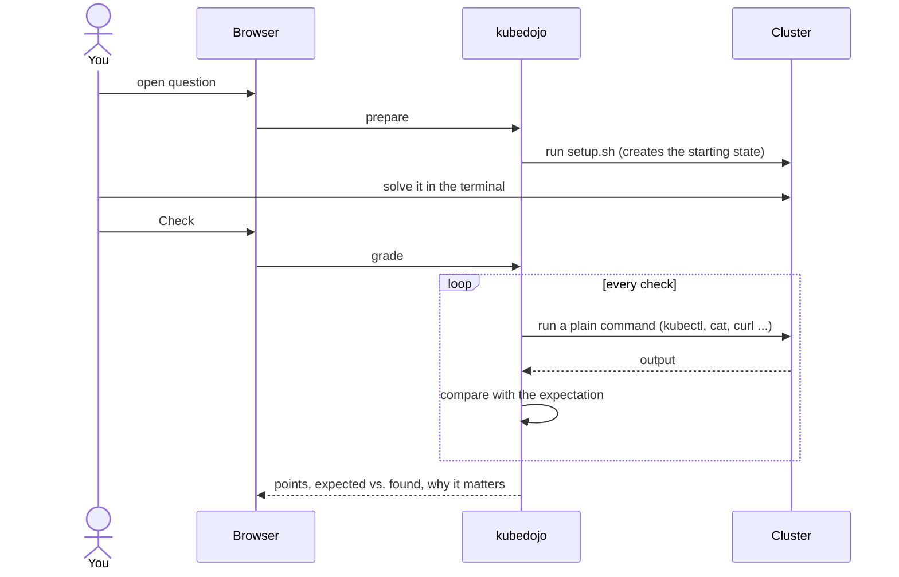
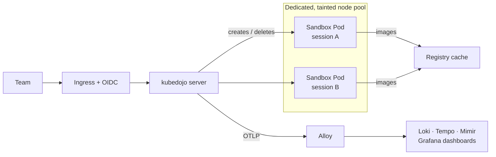
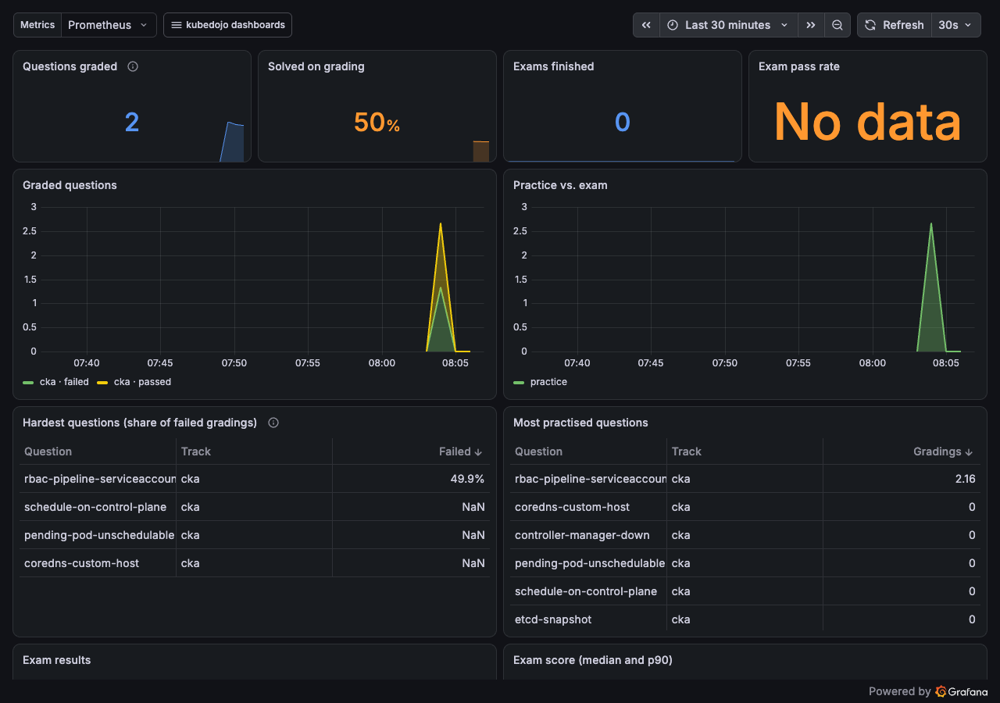

<div align="center">

# kubedojo

**Pass your Kubernetes exam by doing, not by reading.**

Hands-on training for the **CKA** and **CKS** exams: real kubeadm clusters, a real terminal in your
browser, tasks in exam format — graded automatically, with an explanation for every point you miss.

[](https://github.com/Mistral-valaise/kubedojo/actions/workflows/ci.yaml)
[](https://github.com/Mistral-valaise/kubedojo/releases)
[](LICENSE)


[Quick start](#quick-start) · [What you can do](#what-you-can-do) · [How it works](#how-it-works) · [Run it for your team](#run-it-for-your-team) · [Contribute](#contributing)



</div>

## Why kubedojo

The CKA and CKS are performance exams: two hours, a terminal, real clusters. Reading does not prepare
you for that — repetition under exam conditions does. kubedojo gives you exactly that loop, on your own
machine, for free:

| | |
|---|---|
| 🎯 **Exam-format tasks** | 58 original questions (37 CKA, 21 CKS) across all exam domains, weighted like the real exams. |
| 🖥️ **Real clusters** | kubeadm, systemd, kubelet, etcd, static Pods. Break a kubelet, restore etcd, encrypt Secrets at rest. |
| ✅ **Feedback that teaches** | Every check shows what was expected, what was found, why it matters — and the command that checked it. |
| ⏱️ **Timed simulations** | 120 minutes, no hints, a report with your score per domain and a clear pass or fail. |
| 🔒 **Nothing leaves your machine** | Runs locally in Docker. No account, no cloud, no time limit. |

Every question is **proven**: an automated test sets it up, confirms the checks fail, applies the
reference solution and confirms they pass — on every commit.

## Quick start

You need [Docker](https://docs.docker.com/get-docker/) (Docker Desktop, OrbStack or Colima) with at least
4 GB of memory — 8 GB for full exams — and [kind](https://kind.sigs.k8s.io/).

```bash
brew install kind
```

Download the binary for your platform from the
[latest release](https://github.com/Mistral-valaise/kubedojo/releases/latest), unpack it and run:

```bash
./kubedojo up
```

`kubedojo up` checks your machine, builds the two sandbox images on first run (a few minutes, once) and
opens <http://127.0.0.1:4400>. Pick a track, open a question, and a cluster is ready in about half a
minute.

<details>
<summary>Build from source</summary>

Needs Go 1.26+ and Node 22+.

```bash
git clone https://github.com/Mistral-valaise/kubedojo && cd kubedojo
make build
./bin/kubedojo up
```
</details>

<details>
<summary>Commands and flags</summary>

```text
kubedojo up          Start kubedojo locally and open it in your browser
kubedojo doctor      Check that this machine can run sandboxes
kubedojo down        Remove every sandbox kubedojo created
kubedojo ratings     Show the feedback learners left on questions
kubedojo content lint | test | export
```

Useful flags for `up`: `--observability` (local Grafana with dashboards), `--addr`, `--no-open`,
`--kubernetes-version`, `--registry-cache=false`. Set `ANTHROPIC_API_KEY` to enable the optional AI tutor.
</details>

macOS is the primary platform. Linux works the same way; `kubedojo doctor` tells you if the inotify limits
need raising for several clusters. On Windows, run kubedojo inside WSL 2 with Docker Desktop's WSL
integration; the native Windows build compiles but is not tested yet.

## What you can do



### Learn — the 20% that solves 80%

One short lesson per exam domain, written as a cheat sheet you can finish in five minutes. Click any
command or name to copy it.



### Practise — one question, instant feedback

The task on the left, `candidate@terminal` on the right. Connect to the cluster with `ssh`, solve the
task, press **Check**. Each check tells you what it expected, what it found and why that matters.
Stuck? Three hints, from a nudge to nearly the command, then the worked solution. Commands in hints and
solutions have a **Run** button that types them into your terminal.

### Simulate — the exam, timed

A full exam is 16–17 tasks in 120 minutes across several clusters, weighted by domain like the real
thing. Flag tasks, keep notes, no feedback until you finish. Then you get the report: pass or fail, your
score per domain, and every check of every task.



### Track — know when you are ready

kubedojo keeps your best result per question, weights it like the exam and tells you what to practise
next.

| Tracks | Report |
|---|---|
|  |  |

## How it works



Each cluster is a set of `kindest/node` containers — real systemd, kubelet, kubeadm, etcd and static
Pods — extended with sshd and a `candidate` user, so `ssh cka3827` works like in the exam.

### How a question is graded



Checks are plain commands with an expected result, so the grader never knows more than you could find
out yourself. A question is a directory with a task, checks, a setup script and a reference solution —
see [docs/writing-questions.md](docs/writing-questions.md).

## Run it for your team



```bash
helm install kubedojo deploy/helm/kubedojo -n kubedojo --create-namespace \
  --set ingress.enabled=true --set ingress.host=kubedojo.example.com \
  --set oidc.enabled=true --set oidc.issuerURL=... --set oidc.clientID=... --set oidc.existingSecret=kubedojo-oidc \
  --set sandbox.nodeSelector."kubedojo\.dev/pool"=sandbox --set sandbox.tolerationKey=kubedojo.dev/sandbox \
  --set telemetry.otlpEndpoint=http://alloy.monitoring.svc:4318
```

In hosted mode every session gets its own Pod running Docker-in-Docker, in which the same sandbox is
created.

> [!WARNING]
> Sandbox Pods are **privileged**. Hosted mode is for one team that trusts each other, on a dedicated
> node pool, behind authentication. Read [docs/deployment.md](docs/deployment.md) before you expose it.

### Observability

kubedojo speaks OpenTelemetry. Point `OTEL_EXPORTER_OTLP_ENDPOINT` (or `telemetry.otlpEndpoint` in the
chart) at an OTLP/HTTP receiver such as Grafana Alloy and you get traces, metrics and logs. The chart
ships three Grafana dashboards — platform health, sessions & sandboxes, learning analytics — and alert
rules. Try them locally with `kubedojo up --observability`.



Details and the metric reference: [docs/observability.md](docs/observability.md).

## Scope and limits

- The kind driver covers everything that works on a container-based node. Tasks that need a real kernel
  boundary or a package manager on the node — AppArmor, gVisor, Falco with eBPF, `apt`-based kubeadm
  upgrades — are not included yet. They are planned for a VM driver; the driver interface is in place.
- Hosted mode is single-tenant. It is not a hardened multi-tenant service.
- Kubernetes moves fast and so do the exams. Lessons and questions target Kubernetes v1.37.

## Contributing

Questions and lessons are plain files under [`content/`](content), and new questions are very welcome —
`kubedojo content test --question <id>` tells you whether yours works. Start with
[CONTRIBUTING.md](CONTRIBUTING.md).

All content is original. Please do not submit questions copied from commercial exam simulators or from
the real exams.

Questions can also be exported as [Killercoda](https://killercoda.com) scenarios:
`kubedojo content export --format killercoda`.

kubedojo is not affiliated with or endorsed by the Linux Foundation or the CNCF. CKA and CKS are
trademarks of the Linux Foundation.

## License

[Apache-2.0](LICENSE)
