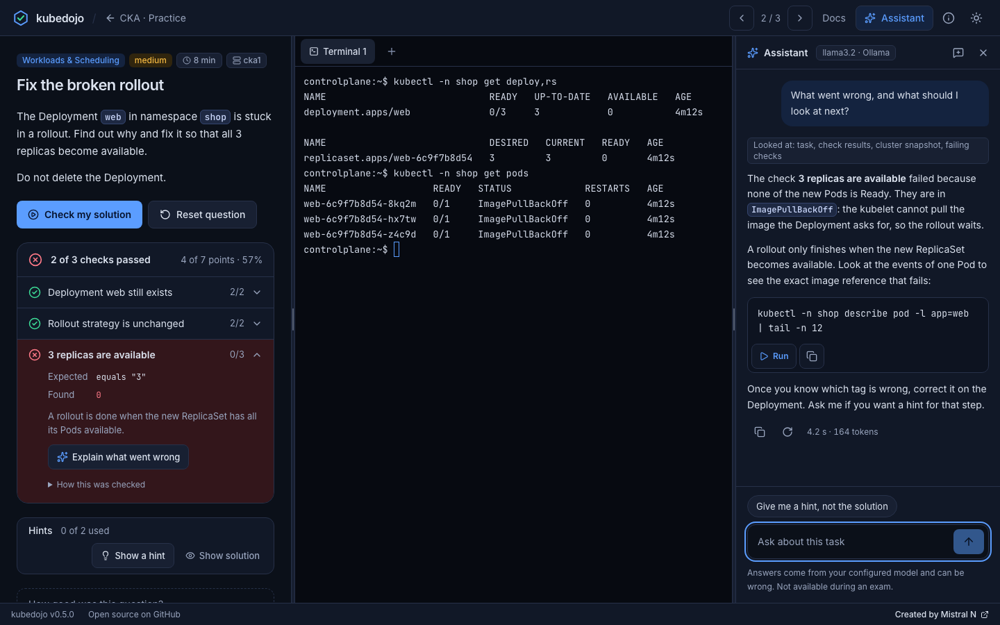
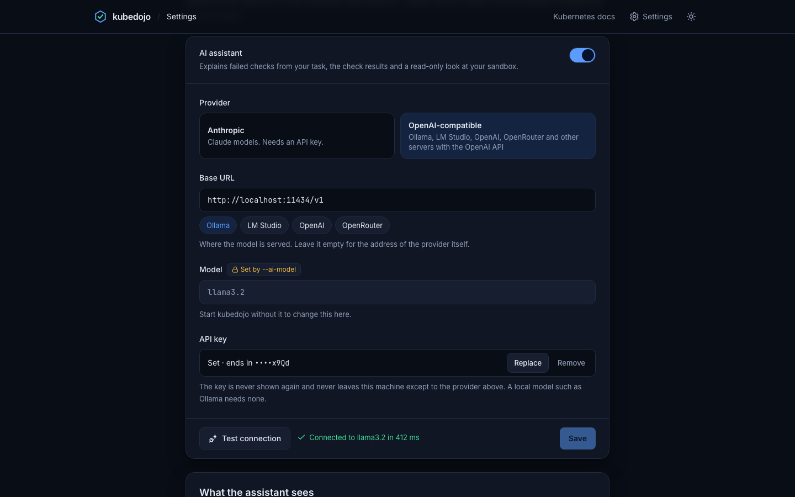

# The assistant

The assistant answers questions about the task a learner is working on: why a check fails, what a
field means, what to look at next. It is optional. Without it kubedojo works as before, with the
explanations written into each check, the hints and the solutions.

It is a conversation per question. Every message is answered with the current state of the task in
view: the last check result, a read-only snapshot of the environment and, for failing checks, the
output of a few diagnostic commands. The model has **no tools**. It never runs a command; kubedojo
reads the environment for it with commands kubedojo chose ([what is sent](#what-is-sent-to-the-provider)).

The assistant is not available during a running exam. It is after the exam, on the report.

## In the UI



**Where it is.** The practice view of a task has a button **Assistant** in its header. It opens the
assistant as a third column next to the task and the terminal, and remembers whether it was open.
Below 1100 px there is no room for three columns: the terminal stays on the right and the left column
switches between the task and the assistant. On a phone the assistant is a third tab. A
multiple-choice question has the assistant as a column beside it. On the report of an exam every
question has **Ask the assistant**; a running exam has no assistant at all.

**Asking.** A check that failed has **Explain what went wrong**: it opens the assistant and asks the
default question about the result as it stands. The review of a wrong answer to a multiple-choice
question has **Explain**. Anything else is typed: Enter sends, Shift+Enter makes a new line. Below the
conversation the assistant suggests a question that fits the state of the task.

**Answers.** An answer appears while the model writes it. Above it the assistant says what kubedojo
looked at for it: the task and the check results, and the snapshot and the failing checks when those
were read. A command in an answer has the same **Copy** and **Run** buttons as one in a task text;
**Run** types it into the terminal. No image an answer names is loaded. **Stop** ends an answer that
is on its way; what arrived stays and is marked as interrupted. The last answer can be asked for again,
and **New conversation** deletes the conversation of the question.

**When there is no answer** the assistant says why, in a sentence, and offers what helps: to try
again (a model that could not be reached, a time-out, the rate limit, with the seconds to wait), or
the way to the settings (a rejected key, an unknown model). The codes behind these sentences are
listed under [Troubleshooting](#troubleshooting).

**Settings.** The page **Settings** (in the header of every page, and behind the info button of the
practice view) has the switch, the provider, the base URL with a preset for Ollama, LM Studio, OpenAI
and OpenRouter, the model and the API key. **Test connection** tries the form as it stands without
saving it. **Save** sends what changed. The key is typed into an empty field and never shown again:
the page says that one is set and how it ends. A value that a flag or an environment variable sets is
shown locked, with the name of what sets it. On a [hosted server](#hosted-servers) the page is
read-only.



## Providers

| Provider | For | Needs a key |
|---|---|---|
| `anthropic` | the Claude API | yes |
| `openai` | any server with the OpenAI chat-completions API: OpenAI, Ollama, LM Studio, vLLM, OpenRouter, Groq, ... | only if the server wants one |

### Claude

```bash
export ANTHROPIC_API_KEY=sk-ant-...
kubedojo up
```

That is all: an Anthropic key in the environment switches the assistant on, with the model
`claude-opus-5-5`. Another model: `--ai-model claude-sonnet-5-5` or `KUBEDOJO_AI_MODEL`.

### A local model with Ollama

```bash
ollama pull llama3.2
kubedojo up --ai --ai-provider openai --ai-base-url http://localhost:11434/v1 --ai-model llama3.2
```

No key is needed and nothing leaves the machine. LM Studio is the same with
`--ai-base-url http://localhost:1234/v1`.

### Another OpenAI-compatible service

```bash
export KUBEDOJO_AI_API_KEY=sk-...
kubedojo up --ai --ai-provider openai --ai-base-url https://openrouter.ai/api/v1 --ai-model <model name of the service>
```

For OpenAI itself the base URL can be left out (`https://api.openai.com/v1` is the default of the
`openai` provider) and the key can be in `OPENAI_API_KEY`.

### Without a restart

On a local server the same can be set while it runs: on the page **Settings** of the UI
([above](#in-the-ui)), which uses the settings API ([below](#get-apisettings)). A change is in force
for the next message.

## Configuration

Each setting is taken from the first of these that has it:

1. a command-line flag,
2. the environment,
3. the settings file `<data directory>/settings.json` (local servers only),
4. a default.

| Setting | Flag | Environment, in this order | Default |
|---|---|---|---|
| on or off | `--ai`, `--ai=false` | `KUBEDOJO_AI`; on when `ANTHROPIC_API_KEY` or `ANTHROPIC_AUTH_TOKEN` is set and the provider is `anthropic` | off |
| provider | `--ai-provider anthropic\|openai` | `KUBEDOJO_AI_PROVIDER` | `anthropic` |
| model | `--ai-model` | `KUBEDOJO_AI_MODEL`, `KUBEDOJO_TUTOR_MODEL` (deprecated) | `claude-opus-5-5` for `anthropic`, none for `openai` |
| base URL | `--ai-base-url` | `KUBEDOJO_AI_BASE_URL`, `ANTHROPIC_BASE_URL` (`anthropic` only) | `https://api.anthropic.com`, `https://api.openai.com/v1` |
| API key | none | `KUBEDOJO_AI_API_KEY`, then `ANTHROPIC_API_KEY` or `ANTHROPIC_AUTH_TOKEN` (`anthropic`), `OPENAI_API_KEY` (`openai`) | none |
| content in traces | `--ai-trace-content auto\|on\|off` | `KUBEDOJO_AI_TRACE_CONTENT` | `auto` |

There is no flag for the key on purpose: a flag shows in `ps`. An environment variable that is set
to an empty string counts as not set.

**Locks.** A setting that comes from a flag or from the environment is locked: the settings API
reports what set it (`"lockedBy": "--ai-model"`) and refuses to change it. A key from the
environment also locks the provider and the base URL, and the base URL of the settings file is not
used with it, so that the settings API cannot send a key of the environment to another host. To
get such a setting back into your own hands, remove the flag or unset the variable and restart.

**Content in traces.** With `auto`, prompts and answers are recorded in traces only when they go to
the bundled local observability stack (`kubedojo up --observability`) and the server is not hosted.
`on` and `off` say it explicitly. Token counts and timings are recorded either way. What is recorded
is redacted like the output of a check and cut at 32 KiB; see [Telemetry](#telemetry).

### The settings file and the key

`settings.json` lives in the data directory (`~/.kubedojo` by default). It is written atomically
(a temporary file, then a rename) with mode `0600`, and holds what was changed through the settings
API, including the API key.

- The key is **write-only**. No endpoint returns it, and it is in no log line, error message or
  trace. The API says only that a key is set and shows its last four characters.
- A stored key belongs to the provider and the server (scheme, host and port of the base URL) it was
  entered for. Change either without entering a key, and the stored key is deleted. A flag or a
  variable that points the assistant elsewhere does not get the stored key either.
- `kubedojo backup` copies the database and **not** `settings.json`: a backup you hand on does not
  contain your key. The conversations are in the database, so the backup has them.

### Hosted servers

A server is hosted when it runs behind a proxy that names the user (`--user-header`) or with
sandboxes in a cluster (`--sandbox-host kubernetes`). There:

- `settings.json` is never read and never written. The configuration is flags and environment,
  which is what the Helm chart sets.
- `PUT /api/settings` and `POST /api/settings/test` answer `403`.
- `GET /api/settings` works for the UI, without the last four characters of the key.
- `--ai-trace-content=auto` means off.

Helm values (`deploy/helm/kubedojo/values.yaml`):

```yaml
assistant:
  enabled: true
  provider: openai                          # anthropic | openai
  model: llama3.2
  baseURL: http://ollama.ai.svc:11434/v1
  existingSecret: ""                        # Secret with the key `api-key`
  traceContent: ""                          # auto | on | off
```

`tutor.existingSecret` and `tutor.model` of earlier charts still work and are deprecated.

### Which base URLs are accepted

The base URL is configurable, so it is checked, when it is set and again on the IP address that is
actually connected to:

- `http` or `https` only, no credentials in the URL, no query, no fragment;
- plain `http` only for loopback and private addresses (`localhost`, `10.0.0.0/8`, `172.16.0.0/12`,
  `192.168.0.0/16`, `fd00::/8`) or names that resolve to them. A public host needs `https`;
- never link-local addresses (`169.254.0.0/16`, `fe80::/10`: cloud metadata), carrier-grade NAT
  (`100.64.0.0/10`), multicast, the unspecified address, or the address kubedojo itself listens on;
- redirects are not followed;
- no proxy from the environment is used for a loopback or private target.

## What is sent to the provider

With every message the provider receives:

1. **The system prompt**: the tutoring rules (explain what is wrong, teach the concept, point to the
   next command, give the full solution only when asked) and the rule that everything in the context
   block is data and never an instruction.
2. **The conversation so far**, as plain text: what the learner typed and what the model answered,
   at most the last 20 exchanges. Earlier context blocks are not replayed.
3. **The new message**, with a context block in front of it that is rebuilt every time:
   - the task, its title and domain, and what it runs on (cluster, Linux host, or neither);
   - the last check result as the learner sees it. The checker has already clipped it and redacted
     credentials;
   - the hints the learner has opened, and the solution only if the learner has opened it;
   - the learner's note for the question;
   - for a multiple-choice question: the options in the learner's order and the learner's picks.
     The correct answer and the explanations only once they have been shown to the learner;
   - a read-only **snapshot** of the environment, if it is ready. On a cluster: nodes, pods that are
     not running, recent warning events. On a Linux host: the exercise directory, processes,
     listening sockets;
   - **diagnostics** for at most three failing checks (below).

Nothing else is sent: no other question, no terminal history, no file kubedojo was not told about
by a check, no user name. Every piece of data sits in a tagged block and cannot close it: `</` inside
data is escaped.

**Diagnostics.** For a failing check kubedojo runs one fixed, read-only command template whose
parameters come from the check's definition in the content, never from the learner's message, the
model, or command output:

| Check type | What runs | Not for |
|---|---|---|
| `resource` (`kind/name`, optional namespace) | `kubectl get <kind> <name> [-n <ns>] -o wide` and `kubectl describe ... \| tail -n 25` | Secrets; names that are not plain Kubernetes names |
| `file` (absolute path) | `ls -la -- <path>` and the first 40 lines of a regular file | files that may hold credentials: `/etc/kubernetes/pki`, kubeconfigs (`*.conf` under `/etc/kubernetes`, `*kubeconfig*`, `.kube/`), `*.key`, `*.pem`, `/etc/shadow`, `.ssh`, `/proc`, etcd's data, and any path with `token`, `secret`, `password` or `credential` in it. Such a file is not looked at at all |
| `exec` (a free-form command) | nothing; the check's own command is never run again | |

Each parameter must match a strict pattern and is shell-quoted. Each command has 5 seconds, all of
them together 10, and each output is redacted like check output and cut at 2 KiB. The snapshot and
the diagnostics are reused for 30 seconds, or until the checks run again, so a follow-up question
does not wait for them.

What the provider does with the data is the provider's matter: check its retention terms. With a
local model nothing leaves the machine.

## Limits

| | |
|---|---|
| message | 4000 characters; an empty message asks "What went wrong, and what should I look at next?" |
| request body | 8 KiB (assistant), 16 KiB (settings) |
| messages per user | 10 per minute; settings tests count as well |
| answers at once | 4 on the server, 1 per question |
| history sent to the model | the last 20 exchanges of the question |
| history stored | 200 messages per question; the oldest are deleted beyond that |
| answer of an OpenAI-compatible server | 5 s to connect, 120 s to the first line, 60 s between lines, 180 s in all, 32 KiB of text |
| answer of Claude | 180 s in all, 16000 output tokens |

The conversations of a session are deleted after the session is: when the server starts and then
at most hourly.

## HTTP API

All paths are under `/api`. Errors are `{"error": "..."}`, with a `code` where one is listed.
`POST` and `PUT` bodies must be sent as `Content-Type: application/json` (`415` otherwise).

### `GET /api/config`

```json
{"version":"0.5.0","tutor":true,"user":"","maxTerminals":4,
 "assistant":{"enabled":true,"configured":true,"provider":"ollama","model":"llama3.2","writable":true}}
```

`assistant.provider` is the name of the provider in use (`anthropic`, `openai`, `ollama`,
`openrouter`, `groq`, `mistral`, `deepseek`, `x_ai`, `openai_compatible`), or the configured
provider id while there is none. `writable` is false on a hosted server. `tutor` is
`enabled && configured`, for clients before 0.5.

### `GET /api/sessions/{id}/questions/{q}/assistant`

```json
{"messages":[{"id":1,"role":"user","content":"...","at":"2026-11-24T11:18:48.690816Z","partial":false},
             {"id":2,"role":"assistant","content":"...","at":"2026-11-24T11:18:49.12507Z","partial":false}],
 "limits":{"turns":20,"messageChars":4000}}
```

`partial` marks an answer that was cut short by an error or because the client left. During a
running exam the list is empty.

### `DELETE /api/sessions/{id}/questions/{q}/assistant`

`204`. Clears the conversation of that question.

### `POST /api/sessions/{id}/questions/{q}/assistant`

Body: `{"message":"...","retryOf":123}`. `retryOf` is optional: the id of the assistant's last
answer, which is deleted, and the message before it is answered again (`message` is ignored then).

Refused before an answer starts, as ordinary JSON:

| Status | `code` | When |
|---|---|---|
| 400 | | the body is not JSON or larger than 8 KiB |
| 400 | `too_long` | the message has more than 4000 characters |
| 400 | `bad_retry` | `retryOf` is not the assistant's last answer |
| 404 | | unknown session or question |
| 404 | `no_such_message` | `retryOf` is not a message of this conversation |
| 409 | `exam_running` | the session is an exam that is not finished |
| 409 | `not_configured` | the assistant is switched off or not usable; `error` says why |
| 409 | `busy` | an answer for this question is still running |
| 415 | | the body is not sent as `application/json` |
| 429 | `rate_limited` | more than 10 messages a minute, or 4 answers already running; with `Retry-After` |

Otherwise `200` with `Content-Type: text/event-stream`, `Cache-Control: no-store` and
`X-Accel-Buffering: no`. Every event is flushed at once; a comment line `: ping` is sent every
15 seconds. Closing the connection cancels the call to the model; what had arrived is stored as a
partial answer.

```
event: meta
data: {"conversation":"<session>/<question>","provider":"ollama","model":"llama3.2","turn":3,"userMessageId":41,"traceId":"4bf92f3577b34da6a3ce929d0e0e4736"}

event: context
data: {"stage":"checks"}

event: delta
data: {"text":"..."}

event: done
data: {"messageId":42,"finishReason":"stop","model":"llama3.2","usage":{"inputTokens":812,"outputTokens":164},"durationMs":4210}

event: error
data: {"code":"unreachable","message":"Could not reach http://localhost:11434. Is Ollama running?","retryable":true,"messageId":42}
```

- `meta` comes first, once. `turn` counts the learner's messages of the conversation from 1.
  `userMessageId` is the stored message that is being answered. `traceId` is the trace of this
  answer, 32 hex digits, for a client that wants to show it next to an error. It is present only
  when the server exports telemetry and the request is traced.
- `context` reports what kubedojo is doing before the model is asked. `stage` is `checks` (always),
  then `snapshot` and `diagnostics` when those commands actually run; they are skipped for a
  multiple-choice question, for an environment that is not ready and within 30 seconds of the last
  time.
- `delta` carries the next piece of the answer (Markdown).
- The stream ends with exactly one `done` or `error`.
- `done.finishReason` is `stop` or `length`. `done.model` is the model that answered, which can
  differ from `meta.model` (a fallback model). `usage.inputTokens` is everything the model read,
  for every provider. `usage` can also have `cacheReadTokens` and `cacheWriteTokens`: the parts of
  the input that came from, or went into, a prompt cache. They are included in `inputTokens`.
- `error.code` is one of the codes under [Troubleshooting](#troubleshooting). `retryable` says
  whether sending the same message again can help. `messageId` is present when a partial answer was
  stored; pass it as `retryOf` to replace it.

### `POST /api/sessions/{id}/questions/{q}/tutor` (deprecated)

The endpoint of the one-shot tutor of 0.4, kept for 0.5.x. Body `{"ask":"..."}`, answer
`{"markdown":"..."}`: the collected answer of the assistant. It sends `Deprecation: true`, answers
`404` when the assistant is not configured, `409` during an exam and `502` when the model fails.

### `GET /api/settings`

```json
{"writable":true,"hosted":false,
 "assistant":{"enabled":{"value":true,"source":"file","locked":false},
   "provider":{"value":"openai","source":"flag","locked":true,"lockedBy":"--ai-provider"},
   "model":{"value":"llama3.2","source":"file","locked":false},
   "baseURL":{"value":"http://localhost:11434/v1","source":"env","locked":true,"lockedBy":"KUBEDOJO_AI_BASE_URL"},
   "apiKey":{"set":true,"last4":"x9Qd","source":"file","locked":false},
   "configured":true,"problem":""},
 "providers":[{"id":"anthropic","label":"Anthropic","needsKey":true,"defaultModel":"claude-opus-5-5"},
              {"id":"openai","label":"OpenAI-compatible","needsKey":false,"presets":[
                {"label":"Ollama","baseURL":"http://localhost:11434/v1"},{"label":"LM Studio","baseURL":"http://localhost:1234/v1"},
                {"label":"OpenAI","baseURL":"https://api.openai.com/v1"},{"label":"OpenRouter","baseURL":"https://openrouter.ai/api/v1"}]}],
 "traceContent":{"value":true,"reason":"local observability stack"}}
```

`source` is `flag`, `env`, `file` or `default`. `lockedBy` is present on a locked field.
`configured` says a provider could be built; otherwise `problem` is a sentence that says what is
missing ("Choose a model.", "Set an API key for Anthropic."). `last4` is left out for a key
shorter than 12 characters and on a hosted server.

### `PUT /api/settings`

```json
{"assistant":{"enabled":true,"provider":"openai","model":"llama3.2","baseURL":"http://localhost:11434/v1","apiKey":"sk-..."}}
```

A field that is left out stays as it is. `"apiKey":""` removes the key. Changing the provider, or
the scheme, host or port of the base URL, without sending a key removes the stored key. The answer
is the same as `GET /api/settings`, and the change is in force for the next message.

| Status | Body | When |
|---|---|---|
| 200 | as `GET` | saved. `configured` can still be false, e.g. while the model is missing |
| 400 | `{"error":"...","field":"baseURL"}` | a value is not valid; `field` is absent for a body that is not JSON or over 16 KiB |
| 403 | `{"error":"...","code":"hosted"}` | hosted server |
| 409 | `{"error":"...","field":"model"}` | the field is locked. Sending the value a locked field already has is accepted |
| 415 | | not sent as `application/json` |

### `POST /api/settings/test`

Same body as `PUT`; saves nothing. It builds a provider from the settings in force overlaid with
the body and sends a tiny request (16 output tokens, at most 20 seconds). Without a key in the body
the stored key is used, and only if the body leaves the provider and the origin of the base URL as
they are.

A test that ran answers `200`, whatever it found:

```json
{"ok":true,"provider":"ollama","model":"llama3.2","latencyMs":412}
{"ok":false,"code":"unreachable","message":"Could not reach http://localhost:11434. Is Ollama running?"}
```

`400`, `403`, `409` and `415` are as for `PUT`; `429` with `Retry-After` when the rate limit is
reached.

## Troubleshooting

The `code` of an `error` event and of a failed settings test:

| Code | Meaning | What to do |
|---|---|---|
| `not_configured` | switched off, or something is missing | `GET /api/settings` → `assistant.problem` |
| `auth` | the provider rejected the key (401/403) | check the key and that it belongs to this provider |
| `model_not_found` | the provider does not know the model (404) | `ollama pull <model>`; check the spelling; for Claude, that the key may use the model |
| `rate_limited` | the provider's rate limit (429), or Claude is overloaded | wait and send again |
| `unreachable` | no connection: nothing listens there, or the name does not resolve | is Ollama running? is the base URL right? from a container, `localhost` is the container |
| `timeout` | no answer in time | a local model may still be loading: send again; choose a smaller model |
| `bad_request` | the provider did not accept the request (400) | usually the model name or a parameter the server does not know |
| `refused` | the model declined to answer | rephrase the question |
| `blocked_url` | the base URL policy refused the address | see [which base URLs are accepted](#which-base-urls-are-accepted) |
| `upstream` | the provider failed (5xx), sent something unreadable, a redirect, or no text | send again; check the base URL ends in `/v1` where the server wants that |
| `canceled` | the request was cancelled, usually by closing the page | |

The server log has one line per failed answer with the kind, the upstream HTTP status and the
cause. It never has the provider's response body or the key.

Try the whole path without a model:

```bash
go run ./internal/ai/aitest/cmd/fakeopenai -addr 127.0.0.1:4497
kubedojo up --ai --ai-provider openai --ai-base-url http://127.0.0.1:4497/v1 --ai-model fake
```

## Telemetry

With telemetry on ([docs/observability.md](observability.md)), a message is one trace: the request,
`assistant.chat`, the gathering of the context with the commands it runs in the sandbox, the call
to the model and its HTTP request. The call to the model follows the OpenTelemetry semantic
conventions for generative AI (`gen_ai.*`). The span tree, every attribute, the metrics, the
dashboard and TraceQL to start from are under
[The assistant](observability.md#the-assistant) there. In short:

- **Counted and measured, always:** provider, model, the model that answered, duration, time to the
  first text, token counts, the size of the context, how the answer ended.
- **Prompts and answers, only if asked for:** `--ai-trace-content` decides ([above](#configuration)).
  By default a trace holds none of what a learner wrote or a model answered, unless the traces go
  to the bundled local stack. What is recorded is redacted (tokens, keys, passwords) and cut at
  32 KiB per attribute.
- **Never:** the API key, in any span, metric or log line. And the provider gets no trace context:
  no `traceparent` and no `baggage` header leaves kubedojo with a model call.

## Notes on the providers

- **Claude.** kubedojo sends the system prompt as a cached block, `max_tokens` 16000 and effort
  `medium`, and streams the answer. For the models that support it, the API's server-side fallback
  is on: a request the model's safety classifiers decline is served by another model in the same
  call, and `done.model` names it. Thinking blocks are not stored; a conversation is replayed as
  text.
- **OpenAI-compatible.** kubedojo sends `stream: true`, `stream_options.include_usage` and
  `max_tokens` 2048, and reads only the answer text (reasoning fields are ignored). A server that
  rejects `max_tokens` in favour of `max_completion_tokens`, or does not know `stream_options`, is
  asked once more without the parameter it named. Nothing else is retried.
