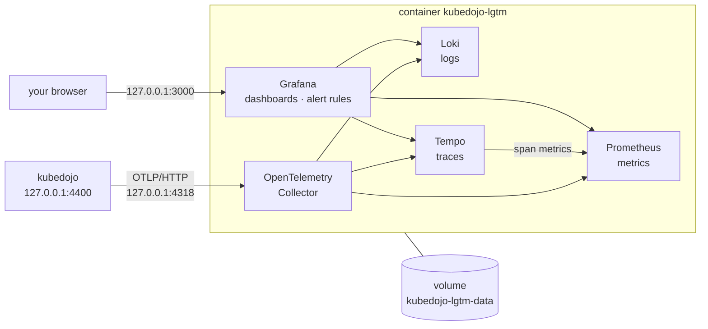

# Observability

kubedojo exports traces, metrics and logs with OpenTelemetry over OTLP/HTTP. It is designed for the
Grafana LGTM stack (Loki, Grafana, Tempo, Mimir) behind Grafana Alloy, and works with any OTLP receiver.

## Enable it

| Mode | How |
|---|---|
| Local, batteries included | `kubedojo up --observability` — starts the [local stack](#the-local-stack) and loads the dashboards. Grafana: <http://localhost:3000> |
| Local, your own collector | `OTEL_EXPORTER_OTLP_ENDPOINT=http://localhost:4318 kubedojo up` |
| Helm, your stack | `telemetry.otlpEndpoint: http://alloy.monitoring.svc:4318` |
| Helm, evaluation | `lgtm.enabled: true` — the same single-container stack in the cluster; see [In a cluster](#in-a-cluster) |

The standard `OTEL_*` environment variables for endpoints, headers and resource attributes are
honoured. The transport is always OTLP over HTTP; `OTEL_EXPORTER_OTLP_PROTOCOL` is not read. Without
an endpoint, telemetry is off and costs nothing.

## The local stack

`kubedojo up --observability` runs one container, `kubedojo-lgtm`, from the image
`grafana/otel-lgtm`. It holds Grafana, Prometheus, Loki, Tempo and an OpenTelemetry Collector. The
image is pinned by version and digest to the one kubedojo is tested with. It needs Docker and nothing
else: no Helm, no cluster.



| | URL |
|---|---|
| kubedojo | <http://127.0.0.1:4400> |
| Grafana, the kubedojo dashboards | <http://127.0.0.1:3000/dashboards?tag=kubedojo> |
| Grafana, alert rules | <http://127.0.0.1:3000/alerting/list> |
| Grafana, Explore (free queries) | <http://127.0.0.1:3000/explore> |
| OTLP/HTTP receiver | `http://127.0.0.1:4318` |

Prometheus, Loki and Tempo are not published. Query them through Grafana.

```sh
kubedojo up --observability        # kubedojo on :4400, Grafana on :3000
kubedojo observability status      # does it run, and where?
kubedojo observability status --verify   # prove that it works, see below
kubedojo observability stop        # stop it, keep the data
kubedojo observability reset       # stop it and delete the data
```

| Flag | Environment variable | Default | |
|---|---|---|---|
| `--observability` | `KUBEDOJO_OBSERVABILITY` | off | start the stack and send telemetry to it |
| `--grafana-port` | `KUBEDOJO_GRAFANA_PORT` | 3000 | local port of Grafana |
| `--otlp-port` | `KUBEDOJO_OTLP_PORT` | 4318 | local port of the OTLP/HTTP receiver |
| `--observability-retention` | `KUBEDOJO_OBSERVABILITY_RETENTION` | 168h | how long metrics, logs and traces are kept; at least 24h |
| `--observability-ephemeral` | `KUBEDOJO_OBSERVABILITY_EPHEMERAL` | off | keep no data volume |
| `--observability-image` | `KUBEDOJO_OBSERVABILITY_IMAGE` | the pinned image | run another `grafana/otel-lgtm` |

`--verify` sends one span, one log record written inside it and one metric sample recorded inside it
to the OTLP receiver, under the service name `kubedojo-verify`, and reads all three back through
Grafana. It also follows the links: the log record must be found by its trace ID, and the metric
sample must carry the trace ID as an exemplar. Then it looks for the data sources, the dashboards and
the alert rules. It takes about two seconds. `kubedojo up --observability` runs the same checks at
start and prints a warning for each that fails; kubedojo itself starts either way.

What to expect:

- **Loopback only.** Grafana and the OTLP receiver listen on 127.0.0.1. Grafana has no login; do not
  publish its port.
- **Starting twice is safe.** A running stack with the same settings is kept. With other settings it
  is replaced; the data stays. If the new ports are taken, the running stack is left alone and the
  error names the port, the flag and, if it is a container, who holds it.
- **Your own collector wins.** If an `OTEL_EXPORTER_OTLP_*ENDPOINT` variable points somewhere else,
  `--observability` stops with an error instead of redirecting your telemetry.
- **Data.** Metrics, logs and traces live in the Docker volume `kubedojo-lgtm-data` and survive
  `stop`, `kubedojo down`, changed settings and a new kubedojo version, including what was written
  seconds before the stop. `kubedojo observability reset` deletes them.
  Your progress is in `~/.kubedojo/kubedojo.db` and is never touched by any of this.
- **Size.** About 550 MB of memory when idle and about 700 MB once telemetry arrives, measured on
  macOS arm64 with Docker Desktop. The image is 0.9 GB to download. The volume starts at about 450 MB,
  most of it Grafana plugins the image installs on first start.
- **Only kubedojo's container.** A container named `kubedojo-lgtm` that kubedojo did not create is
  never stopped or removed; the commands say so and stop.

### A first investigation

One request, followed through all three signals. Start `kubedojo up --observability`, open a
practice question on any hands-on track (the Linux track is the fastest: its host starts in a
second) and wait until it is ready.

1. **The request.** In Grafana open *kubedojo / Platform health*. *Requests by route* shows
   `POST /api/sessions/{id}/questions/{q}/prepare`.
2. **Metric → trace.** Open *kubedojo / Sessions & sandboxes*, panel *Time to a ready sandbox*. The
   dots on the line are exemplars: single sandbox starts. Click one and follow its trace link.
3. **The trace.** Tempo shows the request and, below it, what the request started:
   `question.prepare`, then `sandbox.provision` with `sandbox.host.acquire`, `sandbox.env.create` and
   `sandbox.terminal.connect`, then `question.setup`. The widths show where the time went.
4. **Trace → logs.** Open the span `question.prepare` and use its link to the logs. Loki returns
   the progress lines that were written inside this trace: "Starting host …", "Host … is ready",
   "Exercise … is ready".
5. **Logs → trace.** Each of those lines carries a link back to the trace.
6. **Trace → metrics.** The request span links to the request rate, the error rate and the p95
   latency of its route.

Grafana names these links slightly differently from version to version; they sit on the exemplar,
on the span and on the log line.

The same from the command line, through Grafana's API:

```sh
G=http://127.0.0.1:3000/api/datasources/proxy/uid
NOW=$(date +%s)

# 2. the trace ID of a sandbox start
TRACE=$(curl -s "$G/prometheus/api/v1/query_exemplars" \
  --data-urlencode 'query=kubedojo_sandbox_provision_duration_seconds_bucket' \
  --data-urlencode "start=$((NOW-3600))" --data-urlencode "end=$NOW" |
  jq -r '.data[0].exemplars[-1].labels.trace_id')

# 3. its spans
curl -s "$G/tempo/api/traces/$TRACE" | jq -r '.batches[].scopeSpans[].spans[].name'

# 4. its log lines
curl -s -G "$G/loki/loki/api/v1/query_range" \
  --data-urlencode "query={service_name=\"kubedojo\"} | trace_id = \"$TRACE\"" \
  --data-urlencode "start=$((NOW-3600))" --data-urlencode "end=$NOW" |
  jq -r '.data.result[].values[][1]'
```

### Queries to start from

In Grafana's *Explore*:

| Question | Data source | Query |
|---|---|---|
| How many requests per second, by route? | Prometheus | `sum by (http_route) (rate(http_server_request_duration_seconds_count{service_name="kubedojo"}[5m]))` |
| How slow is the API (p95)? | Prometheus | `histogram_quantile(0.95, sum by (le) (rate(http_server_request_duration_seconds_bucket{service_name="kubedojo"}[5m])))` |
| How long does a sandbox take to start? | Prometheus | `histogram_quantile(0.95, sum by (le, mode) (rate(kubedojo_sandbox_provision_duration_seconds_bucket[1h])))` |
| Which questions fail most often? | Prometheus | `topk(10, sum by (track, question) (increase(kubedojo_check_runs_total{result="failed"}[24h])))` |
| How much memory do my sandboxes use? | Prometheus | `sum by (role) (kubedojo_sandbox_memory_usage_bytes)` |
| What did one session do? | Loki | `{service_name="kubedojo"} \| session = "abcd1234"` |
| Warnings and errors | Loki | `{service_name="kubedojo"} \| detected_level =~ "warn\|error"` |
| Slow sandbox starts | Tempo | `{name = "sandbox.provision" && duration > 60s}` |
| Everything one session did | Tempo | `{span.kubedojo.session.id = "abcd1234"}` |
| Failed operations | Tempo | `{resource.service.name = "kubedojo" && status = error}` |

### When it does not work

| What you see | Why, and what to do |
|---|---|
| `port 3000 (Grafana) is already in use by the container "…"` | Something else has the port. `--grafana-port 3001`, or `--otlp-port` for 4318. |
| `OTEL_EXPORTER_OTLP_ENDPOINT is set to …` | Your shell sends telemetry elsewhere. Unset the variable, or leave `--observability` out and keep your own collector. |
| `the observability stack stopped while starting` | The last lines of the container's log follow the message. `docker logs kubedojo-lgtm` shows all of it. Most often Docker has too little memory: the stack needs about 1 GB free. |
| `the observability stack was not ready after 2m0s` | The first start downloads the image (0.9 GB) and Grafana's plugins. Run the command again; it continues. |
| `a container named kubedojo-lgtm exists that kubedojo did not create` | You have a container of that name of your own. Rename or remove it. |
| Dashboards are empty | Nothing happened yet: open a question. Or the time range is too short: kubedojo exports metrics every 15 seconds. `kubedojo observability status --verify` tells whether the stack itself works. |
| A `! observability: …` line at start | The stack runs but one of the checks failed; the line says which. kubedojo works without it. |
| Old data after an upgrade looks wrong | `kubedojo observability reset` starts from nothing. |

### Tested on

| Platform | How |
|---|---|
| macOS arm64, Docker Desktop | by hand: every command, the investigation above, the alert test |
| Linux amd64, Docker Engine | in CI on every pull request: `make test-observability` |

OrbStack, Colima, Rancher Desktop and Linux arm64 are expected to work but are not tested. The image
is published for amd64 and arm64.

## In a cluster

The chart has two profiles. They are alternatives: with `telemetry.otlpEndpoint` set, kubedojo sends
its telemetry there and not to the evaluation stack.

| | Evaluation: `lgtm.enabled` | Your own stack: `telemetry.otlpEndpoint` |
|---|---|---|
| What runs | one Pod with Grafana, Prometheus, Loki, Tempo and a collector: the stack of `kubedojo up --observability` | whatever you operate: Alloy or a collector in front of Mimir or Prometheus, Loki and Tempo |
| Dashboards | provisioned in the Pod | ConfigMaps for the Grafana sidecar (`dashboards.enabled`, on by default) |
| Alert rules | Grafana-managed rules in the Pod, visible in Grafana only | a `PrometheusRule` (`alerts.enabled`) |
| Sandbox Pod metrics | none: the Pod scrapes no kubelet | the *Sandbox Pods* dashboard, if kubelet/cAdvisor and kube-state-metrics are in the same data source |
| Retention | `lgtm.retention`, default 168h | yours |
| Storage | none by default; `lgtm.persistence.enabled` for a volume (default 10Gi) | yours |
| Login | none by default: everyone who reaches Grafana is its administrator. `lgtm.adminSecret` for a user and password | yours |
| Good for | trying kubedojo, a pilot of a few people | anything you depend on |

### Evaluation

```yaml
lgtm:
  enabled: true
  retention: 168h
  persistence: {enabled: true, size: 10Gi}
  adminSecret: kubedojo-grafana   # keys admin-user and admin-password
```

```sh
kubectl -n kubedojo create secret generic kubedojo-grafana \
  --from-literal=admin-user=admin --from-literal=admin-password="$(openssl rand -base64 18)"
kubectl -n kubedojo port-forward svc/kubedojo-lgtm 3000
```

The chart does not publish Grafana. It is one Pod without redundancy or backup, about 1 GB of memory;
the image is pinned to the version kubedojo is tested with. It was verified on k3s with the same
checks as the local stack: all three signals written and read back, the links between them, the
dashboards and the alert rules.

### Your own stack

```yaml
telemetry:
  otlpEndpoint: http://alloy.monitoring.svc:4318
  headersSecret: {name: kubedojo-otlp, key: headers}   # only if the receiver wants credentials
alerts: {enabled: true}
```

The Secret's key holds headers in the format of `OTEL_EXPORTER_OTLP_HEADERS`, for example
`Authorization=Basic <base64 of user:password>`.

What your stack needs so that everything in this document works:

- **Exemplars**: exemplar storage in Prometheus or Mimir, and a Tempo data source named in the
  Prometheus data source's exemplar settings.
- **Trace IDs on log lines**: the collector must keep the trace context of OTLP log records. Loki
  then has `trace_id` as structured metadata.
- **`service.name` as a metric label** (`service_name`): the dashboards and alert rules filter on it.
- **Links between the data sources** in Grafana:
  [`observability/datasources.yaml`](../deploy/helm/kubedojo/observability/datasources.yaml) shows
  the settings; adapt the UIDs.
- **Retention and storage** are decisions of your stack. As a starting point for a team: 15 days of
  metrics, 7 days of logs and traces. kubedojo itself produces little: a few hundred metric series
  and a handful of log lines and spans per session operation.

A minimal Alloy pipeline:

```alloy
otelcol.receiver.otlp "default" {
  http { endpoint = "0.0.0.0:4318" }
  output {
    metrics = [otelcol.exporter.prometheus.mimir.input]
    logs    = [otelcol.exporter.loki.default.input]
    traces  = [otelcol.exporter.otlp.tempo.input]
  }
}
```

## Metrics

Names as they appear in Prometheus/Mimir:

| Metric | Type | Labels | Meaning |
|---|---|---|---|
| `kubedojo_sessions_active` | gauge | `mode` | live sessions; each owns a sandbox, except in the theory tracks |
| `kubedojo_terminal_connections` | gauge | | open browser terminals |
| `kubedojo_sandboxes_active` | gauge | | sessions that own a sandbox; these count against the session limit |
| `kubedojo_sandboxes_limit` | gauge | | the session limit (`--max-sessions`) |
| `kubedojo_sandbox_provision_duration_seconds` | histogram | `track`, `mode`, `result` | time until a cluster (practice) or a whole exam environment is ready |
| `kubedojo_check_runs_total` | counter | `track`, `question`, `mode`, `result` | graded questions |
| `kubedojo_question_score_ratio` | histogram | `track`, `mode` | share of points per graded question |
| `kubedojo_question_rating` | histogram | `track`, `question` | learner ratings, 1–5 stars (`_sum / _count` is the average) |
| `kubedojo_exams_finished_total` | counter | `track`, `result` | finished exam simulations |
| `kubedojo_exam_score_percent` | histogram | `track` | exam results |
| `kubedojo_sandbox_containers` | gauge | `role` | local only: running sandbox containers |
| `kubedojo_sandbox_memory_usage_bytes` | gauge | `role` | local only: memory the sandbox containers use |
| `kubedojo_sandbox_cpu_usage` | gauge | `role` | local only: CPU cores the sandbox containers use |
| `kubedojo_docker_memory_limit_bytes` | gauge | | local only: memory Docker has |
| `http_server_request_duration_seconds` | histogram | `http_route`, `http_request_method`, `http_response_status_code` | API latency (OTel HTTP semantic conventions) |

The `question` label has one value per question (212 today). No metric carries user or session ids.

## Traces and logs

- **Traces**: one span per API request (named by route). The terminal WebSocket, health checks and
  static files are not traced. Work on a session is traced below the request that started it, also
  when it goes on after the request was answered:

  | Span | Children | When |
  |---|---|---|
  | `question.prepare` | `sandbox.provision`, `question.setup` | a practice question is prepared |
  | `exam.provision` | `sandbox.provision`, `question.setup` per question | an exam environment is built |
  | `sandbox.provision` | `sandbox.host.acquire`, `sandbox.env.create`, `sandbox.terminal.connect` | a cluster or a Linux host is created |
  | `question.check` | | a question is graded |
  | `exam.grade` | `question.check` per question | an exam is graded |
  | `sandbox.destroy` | | a sandbox is removed |

  Spans carry `kubedojo.session.id`, `kubedojo.track`, `kubedojo.mode` and, where it applies,
  `kubedojo.question` and `kubedojo.environment`. Work the server starts itself (an exam whose time
  is up, an idle sandbox) is a trace of its own.
- **Logs**: structured, to stderr (JSON in `serve` mode) and to OTLP, with `service.name=kubedojo`.
  Session lifecycle messages carry a `session` attribute, and every line written inside a span
  carries its trace and span ID.

### How the signals are linked

| From | To | By |
|---|---|---|
| a metric sample | the trace that produced it | exemplars on `http_server_request_duration_seconds`, `kubedojo_sandbox_provision_duration_seconds`, `kubedojo_check_runs_total` and the score histograms |
| a trace | its log lines | the trace ID on the log line |
| a log line | its trace | the same |
| a trace | request rate, error rate and latency of its route | the `service.name` and `http.route` of the span |

The links are real identifiers, never matching timestamps. Session and user never become metric
labels: they exist on spans and log lines only.

## Dashboards

In [`deploy/helm/kubedojo/dashboards`](../deploy/helm/kubedojo/dashboards), installed by the chart as
ConfigMaps labelled `grafana_dashboard: "1"` for the Grafana sidecar:

| Dashboard | Answers | Where |
|---|---|---|
| **Platform health** | Is it up, fast and error free? Request rate, errors, latency with exemplars, slow routes, recent traces, warning and error logs | everywhere |
| **Sessions & sandboxes** | Do we have capacity? Active sessions, sandbox starts and failures, time to a ready sandbox with exemplars | everywhere |
| **Learning analytics** | What do people practise and where do they struggle? Pass rates, share of points, hardest and lowest rated questions, exam results | everywhere |
| **Sandbox containers** | What do the sandboxes of a local kubedojo use? Memory and CPU of the kind nodes, the terminal and the Linux hosts, against the memory Docker has | `kubedojo up --observability` |
| **Telemetry pipeline** | Is telemetry arriving? What the collector receives, hands on, refuses and queues | `kubedojo up --observability`, `lgtm.enabled` |
| **Sandbox Pods** | What do the sandbox Pods of hosted mode use? Memory, CPU, phases, restarts | the chart's ConfigMaps |

A dashboard is only installed where its data exists, so none of them shows empty panels for metrics
that cannot be there. The directory says which: `dashboards/` works with kubedojo's own telemetry,
`dashboards/local/` with a local Docker, `dashboards/lgtm/` with the single-container stack, and
`dashboards/kubernetes/` needs kubelet/cAdvisor and kube-state-metrics in the same data source.

Sandbox containers are measured by kubedojo itself: every 30 seconds it asks Docker for the memory
and CPU of the containers that run its images. The metrics carry the kind of container (`role`:
`node`, `terminal`, `linux`), never a session. There is no disk metric.

### Changing a dashboard

`make lint-dashboards` checks every query without a Grafana: it must parse as PromQL, and it may only
use metrics listed in
[`observability/metrics.json`](../deploy/helm/kubedojo/observability/metrics.json) for the place the
dashboard is installed. The kubedojo part of that file is generated from the instruments
(`UPDATE_CATALOG=1 go test ./internal/telemetry/`), so a renamed metric fails the build until its
dashboards follow. LogQL and TraceQL are not parsed; they are run against the real stack.

## Alerts

The rules are written once, in
[`observability/rules.yaml`](../deploy/helm/kubedojo/observability/rules.yaml), and installed in two
forms:

- **Local stack and `lgtm.enabled`**: Grafana-managed rules, provisioned at start. They are in Grafana
  under *Alerting → Alert rules*, folder *kubedojo*.
- **Your own stack**: `alerts.enabled: true` installs a `PrometheusRule` (Prometheus Operator, or
  Mimir through Alloy's `mimir.rules.kubernetes`).

| Alert | Fires when | Local | Kubernetes |
|---|---|---|---|
| `KubedojoDown` | no metric sample arrives: after 3 minutes locally, 10 in a cluster | ✓ | ✓ |
| `KubedojoHighErrorRate` | more than 5% of API requests return 5xx for 10 minutes | ✓ | ✓ |
| `KubedojoSandboxProvisioningFails` | more than 20% of sandbox starts fail | ✓ | ✓ |
| `KubedojoSandboxProvisioningSlow` | p95 start time above 5 minutes | ✓ | ✓ |
| `KubedojoSessionLimitReached` | every sandbox slot in use for 15 minutes | ✓ | ✓ |
| `KubedojoSandboxMemoryPressure` | sandboxes use more than 85% of Docker's memory | ✓ | |
| `KubedojoTelemetryRefused` | the collector refuses telemetry | ✓ | |

**Visible in Grafana only.** The local stack provisions no contact point and no notification policy.
Alerts go to Grafana's default receiver, an e-mail contact point without a mail server: nothing is
sent. To be notified, add a contact point in Grafana (*Alerting → Contact points*) and make it the
default policy's receiver; that lives in the data volume and survives restarts.

**Try one.** Start `kubedojo up --observability`, wait a minute, then stop kubedojo with Ctrl+C and
leave the stack running. `KubedojoDown` turns *Pending* after about three minutes and *Firing* a
minute later. Start kubedojo again and it returns to *Normal*.

There is no disk alert: kubedojo measures no disk. In a cluster, use the node and kubelet alerts of
your monitoring stack for sandbox nodes.

To change a rule, edit `rules.yaml`, then run
`UPDATE_ALERTS=1 go test ./deploy/helm/kubedojo/observability/` and `make lint-dashboards`.

## Learner feedback

After grading, learners can rate a question with one to five stars and a comment. Averages appear on the
Learning analytics dashboard; the comments stay in the database and are printed, worst questions first, by:

```bash
kubedojo ratings            # add --track cka to filter
```
